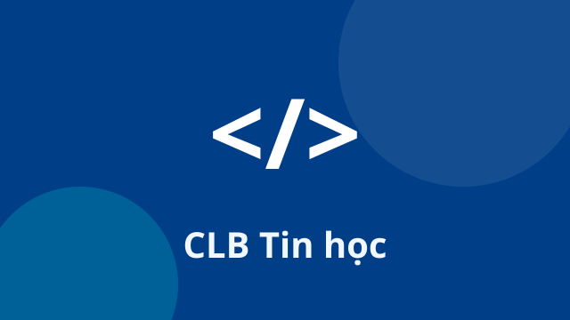

# IN4529 · Chương 1: Web hoạt động thế nào & HTML

- **Học phần:** Lập trình Front End (`IN4529`)
- **Trường:** Trường Đại học Đồng Tháp — Khoa Công nghệ và Kỹ thuật
- **Giảng viên:** ThS. Nguyễn Tuấn Kiệt
- **Năm học:** 2026–2027
- **Từ khoá:** `HTTP`, `HTML5`, `DevTools`

---

## Nội dung Chương 1

- **0** Giới thiệu môn IN4529
- **1.1** Gõ URL rồi chuyện gì xảy ra?
- **1.2** Frontend, Backend, Full-stack
- **1.3** Môi trường: DevTools, VS Code, Node.js, terminal
- **1.5** HTML5: semantic, link, ảnh, bảng, form
- **1.6** Accessibility và SEO cơ bản
- **BT** Bài tập, tổng kết, checkpoint

*(Lược bỏ phần 1.4 Git và GitHub theo yêu cầu).*

---

## Khởi động: bạn đã biết gì?

1. Gõ `dthu.edu.vn` rồi Enter: trang web đó đang nằm ở đâu, và nó đến máy bạn bằng cách nào?
2. Chuột phải trên một trang web → *Xem nguồn trang (View source)*. Đống chữ lạ đó là gì?
3. Một trang web giống một ngôi nhà. Phần nào là **khung** (HTML), phần nào là **sơn** (CSS), phần nào là **điện** (JS)?

---

## 0. Giới thiệu môn IN4529

### Chuẩn đầu ra (CLO)
- **CLO1:** Giải thích web hoạt động thế nào; dựng giao diện semantic, responsive, ai cũng dùng được bằng HTML5, CSS hiện đại, Tailwind CSS.
- **CLO2:** Lập trình tương tác bằng JavaScript/TypeScript; xây ứng dụng React, gọi REST API có đăng nhập (JWT) và có kiểm thử tự động.
- **CLO3:** Xây và đưa lên mạng ứng dụng Next.js có SEO, test e2e, CI/CD.
- **CLO4:** Làm việc nhóm qua Git/GitHub, tự học từ tài liệu chính thức, trình bày kết quả.

### Lộ trình 6 chương & Sản phẩm EduHub Web
1. **HTML** (Tuần 1–2): Trang tĩnh semantic
2. **CSS** (Tuần 2–4): Responsive, design token
3. **JavaScript** (Tuần 4–6): DOM + `fetch` gọi API
4. **React** (Tuần 7–9): SPA, Vite + Router
5. **API** (Tuần 9–12): axios, JWT, test
6. **Next.js** (Tuần 13–15): SSR, CI, deploy

Sản phẩm xuyên suốt: **EduHub Web** — cổng web câu lạc bộ (CLB) & sự kiện cho sinh viên ĐH Đồng Tháp với 3 vai trò:
- **Khách:** Xem CLB, sự kiện; tìm kiếm, lọc; xem chi tiết.
- **Thành viên:** Đăng ký, đăng nhập; đăng ký tham gia sự kiện; xem mã check-in.
- **Quản trị:** Thêm/sửa/xoá CLB, sự kiện; xác nhận đăng ký; check-in người tham gia.

### Cách đánh giá

| Thành phần | Nội dung | Trọng số |
|---|---|---:|
| Chuyên cần | Có mặt, đúng giờ, làm “Thử ngay” trên lớp | 10% (`0.1`) |
| Bài tập chương | 6 bài Ch1–6, nộp qua GitHub, chấm theo rubric | 15% (`0.15`) |
| Kiểm tra giữa kỳ | Trắc nghiệm + đoạn code ngắn, 30 phút, tuần 8 (Ch1–3) | 10% (`0.1`) |
| Thuyết trình nhóm | Tuần 15, chủ đề mở rộng | 10% (`0.1`) |
| Đồ án EduHub Web | Nhóm ≤ 3: sản phẩm deploy + báo cáo + vấn đáp | 55% (`0.55`) |

---

## 1.1 Gõ URL rồi chuyện gì xảy ra?

### Ví dụ đời thường: gọi món ở quán ăn
- **Khách gọi món:** Bạn (`client`) ghi phiếu “1 cơm tấm” → phiếu đó là **request**.
- **Bếp nấu:** Bếp (`server`) nhận phiếu, chuẩn bị món theo đúng yêu cầu.
- **Mang món ra:** Món ăn mang ra là **response**. Hết món? Bếp báo “hết” — giống lỗi **404**.
- **Sổ địa chỉ quán:** Muốn đến quán phải biết địa chỉ — đó là việc của **DNS**.

### Mô hình client – server
- **Client** (trình duyệt: Chrome, Edge…): luôn hỏi trước (gửi **Request**).
- **Server** (máy chủ chạy 24/7, giữ các tệp của trang): chỉ trả lời (gửi **Response**).
- **Frontend** = phần chạy ở client.

### Cấu tạo một URL
`https://sv1.github.io/eduhub-web/events.html#noi-dung`
- `https://` — **giao thức** (protocol)
- `sv1.github.io` — **tên miền** (domain)
- `/eduhub-web/events.html` — **đường dẫn tới tệp** (path)
- `#noi-dung` — **vị trí trong trang** (fragment)

### DNS — cuốn danh bạ của Internet
Máy tính chỉ hiểu **địa chỉ IP** (dãy số, vd `185.199.108.153`). Con người nhớ **tên miền**. **DNS (Domain Name System)** tra tên miền → địa chỉ IP để trình duyệt gửi request tới đúng máy chủ.

### HTTP và HTTPS
- **HTTP:** “ngôn ngữ” client và server nói với nhau — dữ liệu đi dạng chữ thường (ai cũng đọc được).
- **HTTPS:** HTTP + mã hoá bằng **TLS**, chống nghe lén, giả mạo. Trang có form đăng nhập *bắt buộc* phải HTTPS.

### Bên trong một request và response

**REQUEST (client → server):**
```http
GET /eduhub-web/events.html HTTP/1.1
Host: sv1.github.io
Accept: text/html
Accept-Language: vi
```

**RESPONSE (server → client):**
```http
HTTP/1.1 200 OK
Content-Type: text/html; charset=utf-8
Content-Length: 5120

<!DOCTYPE html>
<html lang="vi">…
```

### Method và Status code

| Method | Ý nghĩa |
|---|---|
| `GET` | Lấy về (xem trang) |
| `POST` | Gửi lên (tạo mới) |
| `PUT` | Sửa |
| `DELETE` | Xoá |

| Mã | Nghĩa | Ý nghĩa đời thường |
|---|---|---|
| `200` | OK | Có món, mang ra |
| `301` | Chuyển địa chỉ | Quán dời sang số mới |
| `304` | Dùng bản đã lưu | Món y như lần trước |
| `404` | Không tìm thấy | Thực đơn không có món |
| `500` | Lỗi server | Bếp bị cháy |

- `2xx` thành công · `3xx` chuyển hướng · `4xx` lỗi phía client · `5xx` lỗi phía server.

### Trình duyệt dựng trang & Cây DOM
1. Đọc HTML → **DOM** (Document Object Model — cây phần tử: mỗi thẻ = 1 node, thẻ nằm trong thẻ = nút con).
2. Đọc CSS → **CSSOM** (cây kiểu dáng).
3. Ghép DOM + CSSOM → **Render tree** (cái gì được hiện).
4. **Layout** (tính vị trí, cỡ) → **Paint** (tô pixel).

### Lỗi hay gặp — hiểu sai về web
- ✗ “Internet và Web là một” → ✓ Internet = đường truyền; Web = các trang đi trên đường đó bằng HTTP.
- ✗ “404 nghĩa là server hỏng” → ✓ 404 = gõ sai/thiếu tệp (lỗi 4xx phía client). Server hỏng là 5xx.
- ✗ “Trang có ổ khoá thì an toàn tuyệt đối” → ✓ HTTPS chỉ mã hoá đường truyền; trang lừa đảo vẫn có thể có HTTPS.
- ✗ Mở trang, sửa HTML, không thấy đổi → ✓ Lưu tệp (`Ctrl+S`) rồi tải lại; trình duyệt có thể dùng bản cũ (`304`).

---

## 1.2 Frontend, Backend và Full-stack

### Ví dụ đời thường: một nhà hàng
- **Phòng ăn = Frontend:** Bàn ghế, thực đơn, nhân viên phục vụ — mọi thứ khách nhìn thấy, chạm vào.
- **Nhà bếp = Backend:** Nấu nướng, tính tiền, quản lý kho — khách không thấy nhưng thiếu thì không có món.
- **Kho = Database:** Nơi cất nguyên liệu (dữ liệu) lâu dài.
- **Chủ quán làm hết = Full-stack:** Vừa đứng bếp vừa phục vụ (biết cả hai phía).

### Trong EduHub
`Người dùng` → **Frontend** (`EduHub Web · IN4529`, chạy trong trình duyệt) ↔ `API (JSON)` ↔ **Backend** (`EduHub API · IN4211 / mock API`, chạy trên server) → **Database**.

### Ba cách làm ra trang: Static, SPA, SSR

| Kiểu | Cách hoạt động | Chương |
|---|---|---|
| **Static** (trang tĩnh) | Server gửi tệp HTML viết sẵn. Ai xem cũng như nhau. | Ch1–3 |
| **SPA** (ứng dụng 1 trang) | Server gửi khung rỗng + JS. Trình duyệt tự dựng giao diện, gọi API. | Ch4–5 · React |
| **SSR** (dựng trên server) | Mỗi request, server dựng HTML đầy đủ rồi mới gửi về. | Ch6 · Next.js |

### Lỗi hay gặp — FE/BE
- ✗ “Frontend chỉ là vẽ cho đẹp” → ✓ Frontend còn lo dữ liệu, trạng thái, tốc độ, accessibility.
- ✗ Kiểm tra dữ liệu ở frontend là đủ → ✓ Frontend kiểm để báo lỗi nhanh; backend **vẫn phải** kiểm lại.
- ✗ “SPA lúc nào cũng tốt hơn trang tĩnh” → ✓ Chọn theo nhu cầu: trang giới thiệu → static; app nhiều tương tác → SPA.
- ✗ Để mật khẩu, khoá bí mật trong HTML/JS → ✓ Ai cũng xem được mã frontend (View source) — bí mật để ở backend.

---

## 1.3 Môi trường làm việc

### Bộ công cụ Chương 1
- **Chrome + DevTools (`F12`):** Soi cấu trúc, request, lỗi.
  - **Elements:** xem/sửa cây DOM (sửa ở đây chỉ là tạm, tải lại là mất).
  - **Network:** xem từng request (status code, Headers, Content-Type).
  - **Console:** xem lỗi đỏ, chạy thử JS.
- **VS Code:** Mở cả thư mục (*File → Open Folder…*, không mở lẻ tệp); gõ `!` rồi `Tab` trong file `.html` để tạo khung HTML5 sẵn.
- **Live Server (Ritwick Dey):** Chuột phải `index.html` → *Open with Live Server* (`127.0.0.1:5500`), lưu là tự tải lại.
- **Terminal cơ bản:**
  - `pwd` (đang đứng ở đâu), `ls` (liệt kê tệp), `cd ten-thu-muc` (vào thư mục), `cd ..` (lùi ra), `mkdir assets` (tạo thư mục), `code .` (mở VS Code), `node -v` (kiểm tra Node.js).
  - Terminal luôn chạy lệnh **trong thư mục hiện tại** — đứng sai chỗ là lệnh làm sai chỗ.
- **Node.js 24 LTS & `npx`:**
  - `npx -y html-validate@latest "*.html"` → kiểm tra lỗi cú pháp HTML (kỳ vọng: 0 lỗi, exit 0).

### Lỗi hay gặp — môi trường
- ✗ Bấm đúp mở `file:///.../index.html` → ✓ Mở bằng Live Server (`http://127.0.0.1:5500`) như trang thật.
- ✗ `'node' is not recognized...` ngay sau khi cài → ✓ Đóng và mở lại terminal / VS Code để nhận PATH mới.
- ✗ Chạy lệnh ở sai thư mục → ✓ `pwd` trước, rồi `cd` vào đúng thư mục dự án.
- ✗ Sửa ở tab Elements rồi tưởng đã lưu → ✓ DevTools chỉ sửa tạm; sửa thật trong VS Code rồi `Ctrl+S`.

---

## 1.5 HTML5

### Cấu tạo phần tử HTML
`<a href="events.html">Sự kiện</a>`
- Thẻ mở `<a ...>`, thuộc tính `href="events.html"`, nội dung `Sự kiện`, thẻ đóng `</a>`.
- HTML không “vẽ” gì cả — nó **dán nhãn** cho nội dung để trình duyệt và máy đọc màn hình hiểu.

### Khung một tài liệu HTML5

```html
<!DOCTYPE html>
<html lang="vi">
  <head>
    <meta charset="utf-8">
    <title>Lịch sự kiện · EduHub Web</title>
  </head>
  <body>
    <main id="noi-dung">
      <h1>Lịch sự kiện</h1>
    </main>
  </body>
</html>
```

- `head` = thông tin về trang · `body` = thứ người dùng thấy · `lang="vi"` = đọc đúng tiếng Việt · `charset="utf-8"` = không lỗi dấu.

### Thẻ semantic (chia trang thành vùng có nghĩa)
Tránh “Div soup” (dùng toàn `<div>`), hãy dùng thẻ semantic:
- `<header>`: đầu trang
- `<nav>`: khối điều hướng (`nav > ul > li > a`)
- `<main>`: nội dung chính (**mỗi trang một**)
- `<section>`: một phần có tiêu đề
- `<article>`: mẩu đứng riêng được (1 sự kiện, 1 bài viết)
- `<footer>`: chân trang

Ví dụ `<header>` + `<nav>` và `<main>` + `<section>` + `<article>`:

```html
<a href="#noi-dung">Bỏ qua, đến nội dung chính</a>
<header>
  <a href="index.html">
    
  </a>
  <nav aria-label="Điều hướng chính">
    <ul>
      <li><a href="index.html" aria-current="page">Trang chủ</a></li>
      <li><a href="events.html">Sự kiện</a></li>
      <li><a href="index.html#cau-lac-bo">Câu lạc bộ</a></li>
      <li><a href="register.html">Đăng ký thành viên</a></li>
    </ul>
  </nav>
</header>

<main id="noi-dung">
  <section aria-labelledby="su-kien-sap-toi">
    <h2 id="su-kien-sap-toi">Sự kiện sắp tới</h2>
    <article>
      <h3><a href="event-detail.html">Workshop: Làm website đầu tiên với HTML</a></h3>
      
      <p>
        <time datetime="2026-10-17T07:30+07:00">07:30, thứ Bảy 17/10/2026</time> ·
        Phòng máy B1.203 · CLB Tin học
      </p>
    </article>
  </section>
</main>
```

### Liên kết `<a>`
- **Đường dẫn tương đối:** `events.html` (trang cùng website — chạy được cả local lẫn Pages)
- **Đường dẫn tuyệt đối:** `https://github.com/signup` (website khác)
- **Mảnh `#id`:** `#noi-dung` hoặc `index.html#cau-lac-bo` (nhảy tới phần tử có `id` đó)
- **Email:** `mailto:eduhub@dthu.edu.vn`

### Ảnh ``
- `alt`: chữ thay thế (máy đọc màn hình đọc to, hiện khi ảnh lỗi). Tả nội dung, không ghi “ảnh 1”; ảnh trang trí thuần thì `alt=""`.
- `width` / `height`: trình duyệt giữ chỗ trước, trang không bị “giật”.
- `loading="lazy"`: ảnh ở dưới màn hình đầu chỉ tải khi sắp cuộn tới (ảnh đầu trang thì **không** lazy).

### Danh sách: `ul`, `ol`, `dl` và `<time>`
- `<ol>`: có thứ tự (các bước).
- `<ul>`: không thứ tự.
- `<dl>` (`<dt>` + `<dd>`): cặp “tên – giá trị”.
- `<time datetime="2026-10-17T07:30+07:00">...</time>`: thời gian máy đọc được chuẩn ISO.

### Bảng: dữ liệu có hàng và cột
Dùng cho dữ liệu dạng lưới (lịch, điểm, giá) — **không** dùng bảng để dàn trang:

```html
<table>
  <caption>Sự kiện sắp tới của các câu lạc bộ (giờ Việt Nam)</caption>
  <thead>
    <tr>
      <th scope="col">Thời gian</th>
      <th scope="col">Sự kiện</th>
    </tr>
  </thead>
  <tbody>
    <tr>
      <td><time datetime="2026-10-17T07:30+07:00">07:30, T7 17/10/2026</time></td>
      <th scope="row">
        <a href="event-detail.html">Workshop: Làm website đầu tiên với HTML</a>
      </th>
    </tr>
  </tbody>
</table>
```

### Form & Validation gốc
Validation gốc = kiểm tra bằng thuộc tính HTML, chưa cần JavaScript. Nếu sai, trình duyệt hiện bong bóng báo lỗi và **không gửi**.

```html
<form action="register.html" method="get">
  <fieldset>
    <legend>Thông tin sinh viên</legend>
    <p>
      <label for="student-id">Mã số sinh viên <abbr title="bắt buộc">*</abbr></label>
      <input id="student-id" name="studentId" type="text" inputmode="numeric"
             required pattern="[0-9]{10}" maxlength="10"
             aria-describedby="student-id-hint" autocomplete="off">
      <small id="student-id-hint">Gồm đúng 10 chữ số, ví dụ 0024410123.</small>
    </p>
  </fieldset>
</form>
```

- `for` của `<label>` = `id` của `<input>` → bấm chữ là con trỏ nhảy vào ô.
- `name` = tên trường khi gửi đi.

| Type | Dùng cho |
|---|---|
| `text` | Chữ thường |
| `email` | Email (phải có `@`) |
| `password` | Mật khẩu (che chữ) |
| `date` | Chọn ngày |
| `radio` | Chọn 1 trong nhóm (cùng `name`) |
| `checkbox` | Đánh dấu có/không |

| Thuộc tính | Ý nghĩa |
|---|---|
| `required` | Không được bỏ trống |
| `pattern` | Phải khớp mẫu (regex) |
| `minlength` / `maxlength` | Ít nhất / nhiều nhất N ký tự |
| `min` / `max` | Giới hạn số, ngày |
| `autocomplete` | Gợi ý trình duyệt tự điền |

Ngoài ra còn `<select>`, `<textarea>`, `<button type="submit|reset">`. Dữ liệu từ form vẫn phải kiểm lại ở backend.

### `<details>` và mở rộng `<dialog>`
- **`<details>` + `<summary>`:** mở/đóng không cần JavaScript (hợp cho FAQ).
- **`<dialog>`:** hộp thoại gốc của HTML (thuộc tính `open` để hiện, `<form method="dialog">` để đóng; mở dạng modal bằng `showModal()` ở Ch3).

### Lỗi hay gặp — HTML
- ✗ Hai thẻ `<h1>`, hoặc nhảy `h2` → `h4` cho chữ nhỏ → ✓ Một `<h1>`/trang; cấp heading theo cấu trúc, cỡ chữ để CSS lo.
- ✗ `` không `alt` → ✓ Luôn có `alt` mô tả + `width`/`height`.
- ✗ `<label>Email</label><input id="email">` → ✓ `<label for="email">` khớp đúng `id`.
- ✗ Dùng `<b>`, `<font>`, `<center>`, bảng để dàn trang → ✓ Thẻ semantic cho nghĩa; giao diện để CSS (Ch2).
- ✗ Quên đóng thẻ, lồng sai `<p><div>` → ✓ Chạy `npx -y html-validate@latest "*.html"`.

---

## 1.6 Accessibility và SEO cơ bản

- **Accessibility (a11y):** trang web ai cũng dùng được (người khiếm thị dùng máy đọc màn hình, người chỉ dùng bàn phím).
- **SEO:** Google, Zalo, Facebook hiểu trang nói gì để hiện đúng khi tìm kiếm, chia sẻ.
- **Heading đúng thứ tự:** Một `<h1>`; `h1 → h2 → h3`, không nhảy cấp.
- **Landmark & ARIA:** `header`, `nav`, `main`, `footer`; `aria-label` / `aria-labelledby` đặt tên cho vùng; `aria-current="page"` báo trang hiện tại; link *“Bỏ qua, đến nội dung chính”* giúp người dùng phím `Tab` khỏi đi qua cả menu.

### Meta và Open Graph

```html
<title>Lịch sự kiện · EduHub Web</title>
<meta name="description" content="Lịch các sự kiện sắp tới của câu lạc bộ sinh viên...">
<meta property="og:title" content="Lịch sự kiện · EduHub Web">
<meta property="og:description" content="Lịch các sự kiện sắp tới của câu lạc bộ…">
<meta property="og:url" content="https://ten-tai-khoan.github.io/eduhub-web/events.html">
<meta property="og:image" content="https://ten-tai-khoan.github.io/eduhub-web/assets/og-image.png">
<link rel="icon" href="assets/logo.svg" type="image/svg+xml">
```

- `title` + `description` → kết quả Google.
- `og:*` → thẻ xem trước khi dán link vào Zalo/Facebook (`og:url`, `og:image` phải là URL **tuyệt đối** `https://...`).

### Lighthouse: chấm điểm trang
Mở trang → `F12` → tab **Lighthouse** → chọn **Mobile**, tick *Accessibility* + *SEO* → *Analyze page load* (mục tiêu `≥ 95`).

### Lỗi hay gặp — a11y & SEO
- ✗ Mọi trang cùng `<title>EduHub Web</title>` → ✓ Mỗi trang một title riêng.
- ✗ `alt="ảnh"`, `alt="image1.png"` → ✓ Tả điều ảnh muốn nói; ảnh trang trí thuần thì `alt=""`.
- ✗ `og:image = assets/og-image.png` → ✓ URL tuyệt đối, bắt đầu bằng `https://`.
- ✗ Chỉ có `placeholder`, không có `label` → ✓ Placeholder biến mất khi gõ; luôn có `label`.

---

## Bài tập & Tổng kết Chương 1

### Nhiệm vụ EduHub Web 4 trang (`02_Projects/ch01/starter/`)

| Mã | Cấp | Việc | Điểm |
|---|---|---|---:|
| `ch1-T1` | Warm-up | Trang chủ `index.html`: semantic, 3 sự kiện, 6 CLB, FAQ `details` | 20 |
| `ch1-T2` | Applied | `events.html`: bảng 8 sự kiện, `caption`, `th scope`, `time` | 20 |
| `ch1-T3` | Applied | `event-detail.html`: `article`, `dl`, `ol`, `ul` | 15 |
| `ch1-T4` | Applied | `register.html`: form, label, validation gốc | 25 |
| `ch1-T5` | Applied | Meta/SEO, Open Graph; GitHub Pages; ≥ 3 commit | 20 |
| `ch1-T6` | Challenge | Liên kết “Bỏ qua…”, Lighthouse a11y + SEO ≥ 95 | +10 |

### Tổng kết & Câu hỏi tự kiểm tra (Checkpoint — Chương 1)
1. Kể theo thứ tự các bước từ lúc gõ URL đến lúc thấy trang. DNS làm gì?
2. Status code `404` và `500` khác nhau thế nào? Lỗi nào do phía client?
3. Vì sao nên dùng `<main>`, `<nav>` thay vì `<div>`? Kể 2 lợi ích.
4. Viết một ô nhập MSSV bắt buộc, đúng 10 chữ số, có label.
